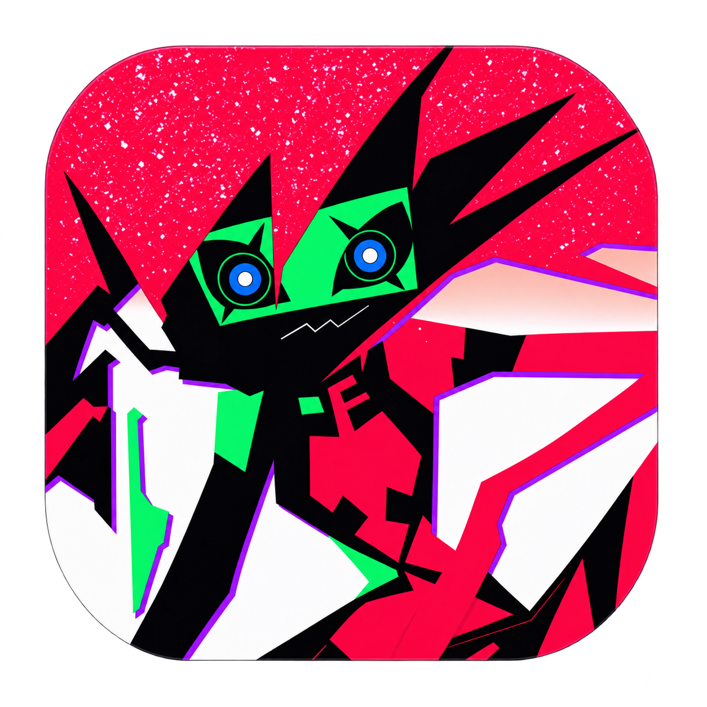

<div align="center">



# ⟡ C A P R I ⟡
### Autonomous Cyber-Pet & Desktop Companion // Project Capricorn

[](scripts/verify.bat)
[](scripts/verify.bat)
[](https://www.python.org/downloads/)
[](https://microsoft.com/windows)
[](https://alphacephei.com/vosk/)
[](LICENSE)

<p align="center">
  <b><a href="#-возможности-и-архитектура">Возможности</a></b> •
  <b><a href="#-быстрый-старт-и-запуск">Быстрый старт</a></b> •
  <b><a href="#-триггерные-слова">Триггеры</a></b> •
  <b><a href="#-матрица-команд">Команды</a></b> •
  <b><a href="#-горячие-клавиши-и-управление">Управление</a></b> •
  <b><a href="#-конфигурация">Конфигурация</a></b>
</p>

</div>

---

**Capri (Капри / Capricorn)** — экспериментальная цифровая личность-энграмма на базе PySide6 (Qt) и Win32 API. Она отображается поверх окон рабочего стола Windows, принимает голосовые команды через локальную офлайн-модель Vosk с подавлением шума Silero VAD, поддерживает текстовый ввод команд через выдвижную кибердеку, уничтожает конфиденциальные файлы протоколом Blackwall и выводит HUD распознавания речи над панелью задач.


## ⚡ Возможности и архитектура

| Модуль | Ключевая механика | Назначение |
| :--- | :--- | :--- |
| 🎙️ **Voice Core** | `Vosk Offline + Silero VAD` | Распознавание речи без интернета и отправки аудио в облако с непрерывным отсечением фоновых шумов |
| 💻 **Cyber-Deck Quick Bar** | `HUD Command Line` | Выдвижная терминальная консоль прямого текстового ввода команд с историей и кнопкой аварийной выгрузки `[TERMINATE]` |
| 🕶️ **Game Mode Stealth** | `Win32 DWM / WS_EX_TRANSPARENT` | Автоматический тихий режим при запуске полноэкранных 3D-игр с клик-сквозной HUD-меткой `CAPRI // STEALTH` |
| 🗑️ **Blackwall Shredder** | `DoD 5220.22-M Multi-Pass` | Безвозвратное криптографическое уничтожение файлов и папок простым перетаскиванием (drag-and-drop) на персонажа |
| ⚡ **Procedural CRT & FX** | `Procedural Shaders / Lightning` | Динамические CRT-сканлайны, глитчи смещения, звуковой синтез речи и молниевый прицел курсора мыши |
| 🎭 **Engram Pranks & Easter Eggs** | `EngramPrankCoordinator / Glitch FX` | Интерактивные сбои сознания (Relic memory dump, вирусное таяние экрана Melting Screen и молниевое уклонение от курсора мыши) с защитой кулдаунами |
| 🎛️ **Cyber Hub (16:9 Menu)** | `QDialog 16:9 / Datamosh FX` | Центрированное 16:9 киберпанк-окно управления параметрами (CORE, AUDIO, VISUAL, SYSTEM) с таб-навигацией и Blackwall Datamosh анимацией |
| 🎵 **Media Orchestrator** | `Spotify MPRIS & YouTube Search` | Управление громкостью, системным звуком, воспроизведением Spotify и интерактивный выбор видео |

## ⚙️ Системные требования

- **Операционная система:** Windows 10 / 11 (64-bit, полная поддержка Multi-DPI и DWM).
- **Python:** [Python 3.10+](https://www.python.org/downloads/) (рекомендуется 3.11/3.12).
- **Распознавание речи:** Модели [`vosk`](https://alphacephei.com/vosk/models) (по умолчанию скачивается легкая русская модель `vosk-model-small-ru-0.22`).
- **Периферия:** Рабочий микрофон для голосового управления.
- **Опционально:** Клиент **Spotify** (нативно через MPRIS / Web API) и **Discord** (Discord Rich Presence статус).

## 🚀 Быстрый старт и запуск

### Вариант 1: Автоматический старт в 1 клик (Рекомендуется)

Скрипт запуска `capriWin.bat` полностью берет на себя инициализацию окружения:
1. Автоматически проверяет наличие виртуального окружения `.venv` и создает его при необходимости.
2. Скачивает и устанавливает все зависимости из `requirements.txt`.
3. Загружает и распаковывает модели Vosk и Silero VAD в папку `models/`, если они отсутствуют.
4. Запускает приложение.

Дважды кликните по файлу `capriWin.bat` или выполните в терминале:
```cmd
capriWin.bat
```

> **Флаги запуска:**
> - `capriWin.bat --console` — запустить приложение с открытым окном терминала для чтения системных логов.

<details>
<summary><b>🛠️ Децентрализованные сервисные скрипты (папка scripts/)</b></summary>

Каждый этап можно запустить автономно:
- `scripts\setup_env.bat` — создание и валидация виртуального окружения `.venv`.
- `scripts\install_deps.bat [--upgrade]` — установка и обновление зависимостей.
- `scripts\download_models.py [--check-only] [--vad] [--vosk]` — утилита загрузки и валидации моделей.
- `scripts\run_app.bat [--console]` — прямой запуск приложения.
- `scripts\verify.bat [--install-hook]` — запуск комплексной локальной верификации (линтер Ruff, компиляция байткода, Mypy, тесты) и установка pre-push Git-хука.
</details>

---

### Вариант 2: Ручная установка (PowerShell / CMD)

Для разработчиков и ручной сборки окружения:

```powershell
python -m venv .venv
.venv\Scripts\Activate.ps1
pip install -r requirements.txt
.venv\Scripts\python.exe scripts/download_models.py
.venv\Scripts\python.exe main.py
```

## 🎙️ Триггерные слова

Капри активируется, когда во фразе звучит ее имя (алгоритм нечеткого сопоставления Damerau-Levenshtein с фонетической нормализацией). Регистр символов не имеет значения; допускаются пробелы, дефисы или слитное написание:

| Группа | Варианты обращения |
| :--- | :--- |
| **Основные** | `капри`, `каприз`, `каприс` |
| **С уточнением** | `капри корд`, `капри корт`, `капри кард`, `капри корн`, `капри кор`, `каприз корд`, `каприз корт`, `каприз кард`, `каприз корн`, `каприз кор`, `каприс корд`, `каприс корт`, `каприс кард`, `каприс корн`, `каприс кор` |
| **Фонетические** | `кэпри`, `кэприз`, `кэприс`, `кепри`, `кеприз`, `кеприс`, `копри`, `коприз`, `коприс` |
| **Раздельные** | `как при`, `кап при` |

## 💻 Матрица команд

Команды можно произносить в микрофон после активации по имени (например, *«Капри, выключи пк»*) либо вводить напрямую в кибердеку-консоль (`Ctrl+Space` или клик по HUD).

### 1. Система, Питание и Диагностика

| Команда | Синонимы и варианты | Описание действия |
| :--- | :--- | :--- |
| **`блокировка`** | <details><summary><i>18 синонимов...</i></summary>`заблокировать`, `заблокируй`, `блокировать`, `заблокировать экран`, `заблокируй экран`, `экран блокировки`, `блокировка экрана`, `лок`, `лок скрин`, `залочь`, `залочить`, `залочь экран`, `залочить экран`, `выключи экран`, `погаси экран`, `супер л`, `заблок`, `я отойду`, `отойду`</details> | Заблокировать рабочий стол Windows (с подтверждением) |
| **`выключи`** | <details><summary><i>14 синонимов...</i></summary>`я спать`, `выключи пк`, `выключить пк`, `выключи компьютер`, `выключить компьютер`, `выруби пк`, `выруби компьютер`, `выключись`, `спокойной ночи`, `шатдаун`, `паверофф`, `поверофф`, `выключение пк`, `выключить`</details> | Безопасное выключение компьютера (с подтверждением) |
| **`перезагрузка`** | <details><summary><i>17 синонимов...</i></summary>`перезагрузи`, `перезагрузить`, `перезагрузи пк`, `перезагрузить пк`, `перезагрузка пк`, `перезагрузка компьютера`, `перезагрузись`, `ребутнись`, `рестартнись`, `ребутни комп`, `выключить и включить`, `перезагрузи компьютер`, `перезагрузить компьютер`, `рестарт`, `ребут`, `ребутни`, `рестартни`</details> | Перезагрузка системы Windows (с подтверждением) |
| **`сон`** | <details><summary><i>13 синонимов...</i></summary>`я гулять`, `спящий режим`, `перевести в спящий режим`, `переведи в спящий режим`, `режим сна`, `усни`, `уснуть`, `замри`, `отдохни`, `передохни`, `приостанови компьютер`, `слип`, `суспенд`</details> | Перевод ПК в спящий энергосберегающий режим (с подтверждением) |
| **`очистить`** | <details><summary><i>29 синонимов...</i></summary>`очисти`, `очистить систему`, `очисти систему`, `очисти пк`, `очисти компьютер`, `очистить пк`, `очистить компьютер`, `очистить диск`, `очисти диск`, `почистить`, `почисти`, `почисти систему`, `почисти пк`, `почисти компьютер`, `почистить систему`, `почистить пк`, `почистить компьютер`, `почистить диск`, `почисти диск`, `удали мусор`, `удалить мусор`, `очисти мусор`, `очистить мусор`, `очисти корзину`, `очистить корзину`, `очистка`, `очистка системы`, `очистка диска`, `клининг`, `clean`, `cleanup`</details> | Фоновая очистка Корзины и временных файлов (`%TEMP%`, `C:\Windows\Temp`) с отчетом |
| **`реестр`** | <details><summary><i>16 синонимов...</i></summary>`сканировать реестр`, `сканируй реестр`, `проверить реестр`, `проверь реестр`, `анализ реестра`, `проверка реестра`, `битые ключи`, `почистить реестр`, `почисти реестр`, `очистка реестра`, `очисти реестр`, `чек реестра`, `registry`, `scan registry`, `check registry`, `clean registry`</details> | Безопасный read-only аудит реестра Windows на остатки удаленного ПО и битые ключи |
| **`дебаг`** | <details><summary><i>10 синонимов...</i></summary>`диагностика`, `самодиагностика`, `отладка`, `статус`, `статус системы`, `состояние`, `состояние системы`, `инфо`, `информация`, `проверка системы`</details> | Диагностика статуса Vosk, таймеров напоминаний и аптайма |
| **`обновление`** | <details><summary><i>12 синонимов...</i></summary>`обновления`, `обновить`, `обновись`, `проверить обновления`, `проверь обновления`, `проверить обновление`, `проверь обновление`, `апдейт`, `чекни обновления`, `страница обновления`, `репозиторий`, `гитхаб`</details> | Открытие страницы релизов репозитория CapriPet на GitHub |

### 2. Звук, Мультимедиа и Spotify

| Команда | Синонимы и варианты | Описание действия |
| :--- | :--- | :--- |
| **`громкость <0-100%>`** | <details><summary><i>6 вариантов...</i></summary>`громкость на`, `звук на`, `поставь звук на`, `выстави звук на`, `сделай звук на`, `уровень звука`</details> | Установить громкость Windows на фиксированный процент или «максимум» / «ноль» с Cyber Audio HUD |
| **`громче [на N]`** | <details><summary><i>7 вариантов...</i></summary>`погромче`, `прибавь звук`, `прибавить звук`, `добавь звук`, `добавить звук`, `увеличь громкость`, `звук громче`</details> | Прибавить системную громкость на шаг (по умолчанию 10% или N) |
| **`тише [на N]`** | <details><summary><i>8 вариантов...</i></summary>`потише`, `убавь звук`, `убавить звук`, `сделай потише`, `убавь громкость`, `убавить громкость`, `снизь громкость`, `звук тише`</details> | Убавить системную громкость на шаг (по умолчанию 10% или N) |
| **`заглуши`** | <details><summary><i>6 вариантов...</i></summary>`выключи звук`, `выключить звук`, `отключи звук`, `отключить звук`, `без звука`, `режим тишины`</details> | Аппаратное отключение системного звука Windows (Mute) |
| **`включи звук`** | <details><summary><i>4 варианта...</i></summary>`включить звук`, `верни звук`, `вернуть звук`, `разглуши`</details> | Включение и восстановление системного звука (Unmute) |
| **`спотифай <трек>`** | <details><summary><i>9 вариантов...</i></summary>`спотик`, `включи музыку`, `поставь музыку`, `включи спотифай`, `включи в спотифае`, `найди музыку`, `найди песню`, `включи песню`, `поставь песню`</details> | Интерактивный поиск и запуск воспроизведения в Spotify |
| **`пауза`** | <details><summary><i>11 вариантов...</i></summary>`поставь на паузу`, `паузу`, `приостанови музыку`, `приостанови`, `стоп`, `останови`, `останови музыку`, `заткнись`, `замолчи`, `помолчи`, `тихо`, `стоп музыка`</details> | Приостановить воспроизведение трека в Spotify |
| **`продолжить`** | <details><summary><i>9 вариантов...</i></summary>`плей`, `играй`, `продолжи`, `продолжи музыку`, `продолжай`, `продолжай играть`, `играй дальше`, `возобнови`, `возобнови музыку`</details> | Возобновить воспроизведение в Spotify |
| **`следующий трек`** | <details><summary><i>17 вариантов...</i></summary>`следующий`, `след`, `некст`, `некст трек`, `скип`, `скипни`, `скип трек`, `скипни трек`, `пропусти`, `пропусти трек`, `другой трек`, `включи другой трек`, `переключи трек`, `следующая песня`, `следующая`, `дальше`, `переключи`</details> | Переключить на следующий трек в очереди |
| **`предыдущий трек`** | <details><summary><i>11 вариантов...</i></summary>`предыдущий`, `прев`, `превиус`, `назад`, `трек назад`, `прошлый трек`, `прошлая песня`, `прошлый`, `верни трек`, `предыдущая песня`, `предыдущая`</details> | Вернуться к предыдущему воспроизводимому треку |
| **`что играет`** | <details><summary><i>15 вариантов...</i></summary>`что сейчас играет`, `какой трек играет`, `какая песня играет`, `что за трек`, `что за песня`, `че играет`, `че за трек`, `че за песня`, `кто поет`, `кто поёт`, `название трека`, `название песни`, `текущий трек`, `текущая песня`, `какой трек`, `какая песня`</details> | Распознать текущий трек через системный медиа-стек MPRIS без входа в аккаунт |
### 3. Процессы и Приложения

| Команда | Синонимы и варианты | Описание действия |
| :--- | :--- | :--- |
| **`запусти <приложение>`** | <details><summary><i>11 вариантов...</i></summary>`запусти приложение`, `запустить`, `запустить приложение`, `открой`, `открыть`, `открой приложение`, `открыть приложение`, `включи приложение`, `включить приложение`, `старт`, `стартуй`</details> | Поиск установленных приложений Windows (Start Menu + App Paths) с интерактивным выбором (1–5) |
| **`убей <процесс>`** | <details><summary><i>17 вариантов...</i></summary>`убей процесс`, `убей приложение`, `убить`, `убить процесс`, `убить приложение`, `закрой`, `закрыть`, `закрой процесс`, `закрыть процесс`, `закрой приложение`, `закрыть приложение`, `заверши`, `завершить`, `заверши процесс`, `завершить процесс`, `прибей`, `прибить`, `стоп процесс`</details> | Интерактивный поиск запущенных процессов, группировка дублей и принудительное завершение (выбор 1–5) |
| **`консоль`** | <details><summary><i>11 вариантов...</i></summary>`терминал`, `дека`, `кибердека`, `ввод`, `строка ввода`, `открой консоль`, `открыть консоль`, `открой терминал`, `открыть терминал`, `открой кибердеку`, `запусти терминал`</details> | Открыть безрамочный Cyber HUD Quick Bar прямого ввода команд с историей и кнопкой `[TERMINATE]` |

### 4. Навигация, Поиск и Эффекты

| Команда | Синонимы и варианты | Описание действия |
| :--- | :--- | :--- |
| **`где мышь`** | <details><summary><i>18 вариантов...</i></summary>`где курсор`, `найди мышь`, `найди курсор`, `поймай мышь`, `поймай курсор`, `потерял мышь`, `потерял курсор`, `потерял мышку`, `верни мышь`, `верни курсор`, `где мышка`, `найди мышку`, `поймай мышку`, `покажи мышь`, `покажи мышку`, `покажи курсор`, `мышь`, `курсор`, `мышка`</details> | Мгновенное наведение тактического молниевого прицела на текущее положение курсора мыши |
| **`глитч`** | <details><summary><i>10 вариантов...</i></summary>`переключить глитч`, `включить глитч`, `выключить глитч`, `глитчи`, `глюки`, `переключить глюки`, `включить глюки`, `выключить глюки`, `эффекты`, `переключить эффекты`</details> | Переключение процедурных экранных CRT-эффектов и искажений |
| **`гугл <запрос>`** | <details><summary><i>10 вариантов...</i></summary>`загугли`, `погугли`, `гуглить`, `искать в гугле`, `найди в гугле`, `поищи в гугле`, `поискать в гугле`, `поиск в гугле`, `найди в интернете`, `поищи в интернете`</details> | Быстрый поиск запроса в браузере по умолчанию |
| **`ютуб <запрос>`** | <details><summary><i>9 вариантов...</i></summary>`ютьюб`, `искать на ютубе`, `найди на ютубе`, `найди в ютубе`, `поищи на ютубе`, `поищи в ютубе`, `поискать на ютубе`, `поиск на ютубе`, `поиск в ютубе`</details> | Поиск видео на YouTube с интерактивным выбором результата по номеру (1–5) |

## 🎮 Горячие клавиши и управление

| Действие / Сочетание | Контекст | Что происходит |
| :--- | :--- | :--- |
| `Ctrl + Space` | Глобальный хоткей | Быстрое включение / отключение голосового прослушивания |
| `Ctrl + Q` | Окно приложения | Завершение работы и выгрузка Капри |
| **ЛКМ (Зажатие и перетаскивание)** | Спрайт Капри | Плавное перемещение персонажа по экрану |
| **Наведение / Клик (во время пасхалки)** | Спрайт Капри | Реактивное молниевое уклонение спрайта от курсора (Cursor Dodge) с саркастичной репликой |
| **ПКМ (Правый клик)** | Спрайт Капри / Трей | 16:9 киберпанк-окно настроек Cyber Hub (переключение режимов, громкость, стелс) |
| **Drag-and-Drop (Файл / Папка)** | Спрайт Капри | Активация **Blackwall Shredder**: безвозвратное уничтожение брошенного файла (с подтверждением) |
| **Клик по HUD над таскбаром** | Панель задач | Открытие Quick Bar кибердеки для текстового ввода команд |

### 🕶️ Игровой режим (Game Mode Stealth)

Капри автоматически детектирует полноэкранные 3D-игры и тяжелые графические приложения через Win32 API (`SHQueryUserNotificationState`):
- Скрывается основной оверлей персонажа и блокируются всплывающие диалоговые окна `CyberHudBubble`.
- Полностью отключаются случайные звуковые реплики, напоминания `PresenceReminder` и пасхалки энграммы.
- Умная фильтрация развёрнутых окон (`WS_MAXIMIZE` / `IsZoomed`): развёрнутые на весь экран офисные приложения, браузеры и мессенджеры (Discord, VS Code, Chrome) не вызывают ложного перехода в игровой режим при переключении по `Alt+Tab`.
- В углу экрана выводится ненавязчивая HUD-метка `CAPRI // STEALTH` с поддержкой сквозного клика (`WS_EX_TRANSPARENT`), не перехватывающая фокус мыши и клавиатуры.
- Действует умный Cooldown (~3 сек) для предотвращения мерцания интерфейса при сворачивании игры через `Alt+Tab`.
- Ручное переключение доступно через контекстное меню: `▶ [GAME] Игровой режим (тишина)`.

## 🔧 Конфигурация

Все настройки сохраняются с использованием Pydantic v2 и атомарной записи на диск:
- **Основной локальный каталог:** `<project_root>/.capri/` (`.capri/config.json`, `.capri/spotify.json`)
- **Системный резервный профиль (fallback):** `%APPDATA%\capri\` (по умолчанию `C:\Users\<User>\AppData\Roaming\capri\`)

| Переменная окружения | Назначение |
| :--- | :--- |
| `CAPRI_VOSK_MODEL` | Абсолютный путь к папке модели Vosk (переопределяет папку `models/`) |
| `SPOTIFY_CLIENT_ID` | Client ID для подключения к Spotify Web API |
| `SPOTIFY_CLIENT_SECRET` | Client Secret для подключения к Spotify Web API |
| `QT_QPA_PLATFORM` | Принудительное переопределение платформенного бэкенда Qt |

> 🔒 **Безопасность:** папка `.capri/` и конфигурационные файлы с токенами занесены в `.gitignore` и никогда не попадают в систему контроля версий.

### 🔍 Источники сканирования для команды «Запусти»

Поиск приложений выполняется локально без сторонних сервисов через системные механизмы Windows:
- Папки ярлыков меню «Пуск»: `%ProgramData%\Microsoft\Windows\Start Menu\Programs` и `%AppData%\Microsoft\Windows\Start Menu\Programs` (файлы `.lnk`)
- Ветки системного реестра `App Paths`: `HKLM\SOFTWARE\Microsoft\Windows\CurrentVersion\App Paths` и `HKCU\SOFTWARE\Microsoft\Windows\CurrentVersion\App Paths`

---

## 📚 Архитектура и внутренняя документация

Подробная инженерная и архитектурная документация проекта:
- 🗺️ **[Архитектурная схема компонентов и C4 диаграммы](docs/architecture.md)** — слои Presentation, Controllers, Core, Audio и шина событий Qt.
- 📂 **[Файловая структура проекта](docs/project_structure.md)** — каноническое ASCII-дерево модулей с описанием зон ответственности.
- ⚙️ **[Спецификация конфигурации](docs/config_spec.md)** — описание Pydantic схем и параметров.

---

## 📜 Лицензия

Проект распространяется под открытой лицензией [MIT License](LICENSE).

<div align="center">
  <sub>Project Capricorn // Soulkiller Engram Substrate • Built with PySide6, Vosk & Win32 DWM</sub>
</div>
