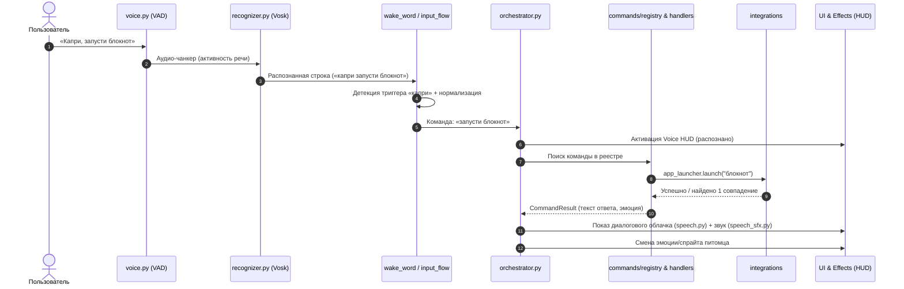

# Архитектура CapriPet

Документ описывает программную архитектуру кибер-питомца CapriPet: взаимодействие подсистем, конвейер обработки речи, выполнение команд и отображение визуальных компонентов на базе PySide6 (Qt).

---

## 1. Общая архитектурная схема (C4 / Container & Component Level)

```mermaid
flowchart TB
    %% Входные сигналы
    subgraph Inputs["1. Источники ввода"]
        Mic["Микрофон (Аудиопоток)"]
        Hotkeys["Горячие клавиши (Ctrl+Space, Ctrl+Q)"]
        Mouse["События мыши / Трей"]
    end

    %% Аудио подсистема
    subgraph AudioSubsystem["2. Аудио и распознавание (capri.audio)"]
        Voice["voice.py<br/>(Захват звука, Silero VAD)"]
        ASR["recognizer.py<br/>(Vosk / Faster-Whisper)"]
        Voice -->|Фреймы речи| ASR
    end

    %% Ядро обработки
    subgraph CoreSubsystem["3. Конвейер ядра (capri.core)"]
        WakeWord["wake_word.py<br/>(Детектор активации «Капри»)"]
        InputFlow["input_flow.py<br/>(Конвейер сессий и подтверждений)"]
        Morphology["morphology.py<br/>(Нормализация, стемминг, числительные)"]
        Settings["settings.py<br/>(Конфигурация .capri/config.json)"]

        WakeWord --> InputFlow
        Morphology -.-> InputFlow
    end

    %% Контроллеры и оркестрация
    subgraph Controllers["4. Контроллеры и управление (capri.controllers)"]
        Orchestrator["orchestrator.py<br/>(Центральный оркестратор)"]
        Inactivity["inactivity_manager.py<br/>(Таймер бездействия)"]
        ActionBridge["action_bridge.py<br/>(Мост асинхронных операций)"]
    end

    %% Команды и интеграции
    subgraph CommandsSubsystem["5. Модульная система команд и интеграции"]
        Registry["commands/registry.py<br/>(Реестр и нечёткий поиск)"]
        Handlers["commands/handlers.py<br/>(Обработчики команд)"]
        Integrations["integrations/<br/>(Spotify, Discord RPC, System, AppLauncher)"]

        Registry --> Handlers
        Handlers --> Integrations
    end

    %% UI и Визуальные эффекты
    subgraph VisualPresentation["6. Графический интерфейс и эффекты (PySide6)"]
        PetWindow["ui/pet_window.py<br/>(Главное окно питомца)"]
        PetRenderer["ui/pet_renderer.py<br/>(Рендерер спрайтов и глитчей)"]
        SpeechHUD["ui/speech.py & speech_sfx.py<br/>(Облачка диалогов и звуки)"]
        VoiceHUD["ui/voice_hud.py<br/>(Cyberpunk Voice HUD над taskbar)"]
        Effects["effects/effects_coordinator.py<br/>(Оверлеи, CRT-глитчи, молнии)"]

        PetWindow --> PetRenderer
    end

    %% Связи между подсистемами
    Mic --> Voice
    Hotkeys --> Orchestrator
    Mouse --> PetWindow

    ASR -->|Распознанный текст| WakeWord
    InputFlow -->|Командная фраза / подтверждение| Orchestrator

    Orchestrator <--> Registry
    Orchestrator --> ActionBridge
    ActionBridge --> Handlers
    Inactivity --> Orchestrator

    Orchestrator -->|Состояние, речь, анимация| PetWindow
    Orchestrator -->|Текст реплики| SpeechHUD
    Orchestrator -->|Статус распознавания| VoiceHUD
    Orchestrator -->|Запуск эффектов| Effects
```

---

## 2. Диаграмма последовательности голосовой команды (Sequence)

Ниже показан путь прохождения голосовой команды от микрофона до исполнения и обратной связи через HUD.

---

## 3. Описание ключевых подсистем

1. **`capri.audio`**: Непрерывный низкоуровневый захват с аудиокарты, отсечение тишины моделью Silero VAD и передача активных отрезков в локальную модель ASR (Vosk).
2. **`capri.core`**: Выделение триггерных фраз имени питомца, лемматизация и стемминг русской речи, поддержание контекста ожидания подтверждения («да/нет» для критических действий).
3. **`capri.controllers`**: Оркестратор выступает диспетчером между событиями аудио, пользовательскими окнами Qt и запуском командных сценариев.
4. **`capri.commands` & `capri.integrations`**: Изолированные обработчики действий — поиск приложений, управление питанием Windows, взаимодействие со Spotify API и Discord RPC.
5. **`capri.ui` & `capri.effects`**: Полностью процедурный киберпанк-интерфейс на PySide6 (frameless-окна с прозрачностью, CRT-сканлайны, синтез речи в духе ретро-консолей, HUD-индикаторы).
