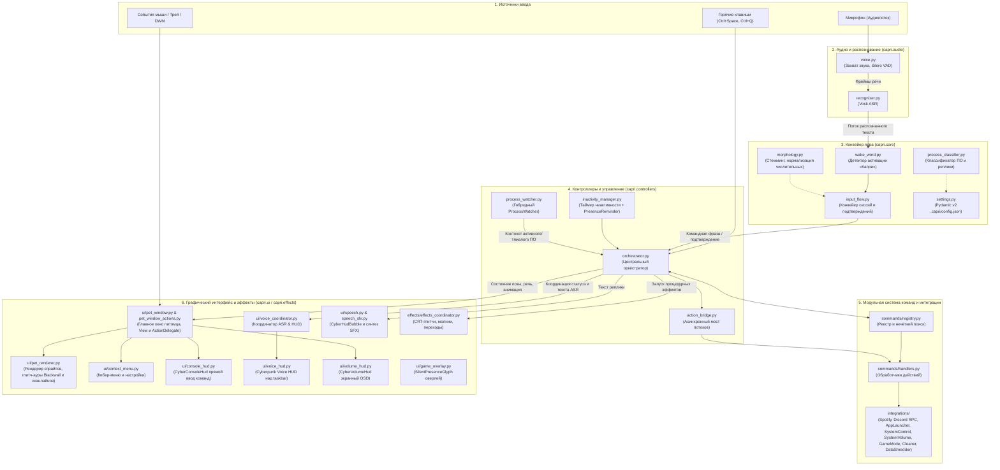
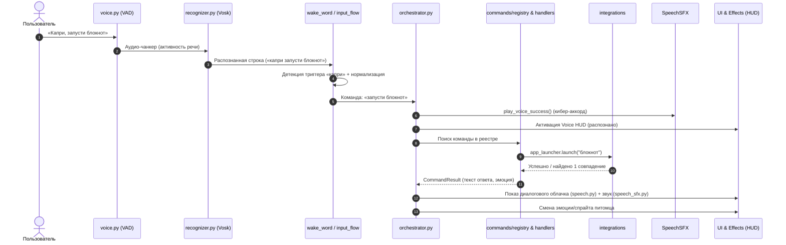
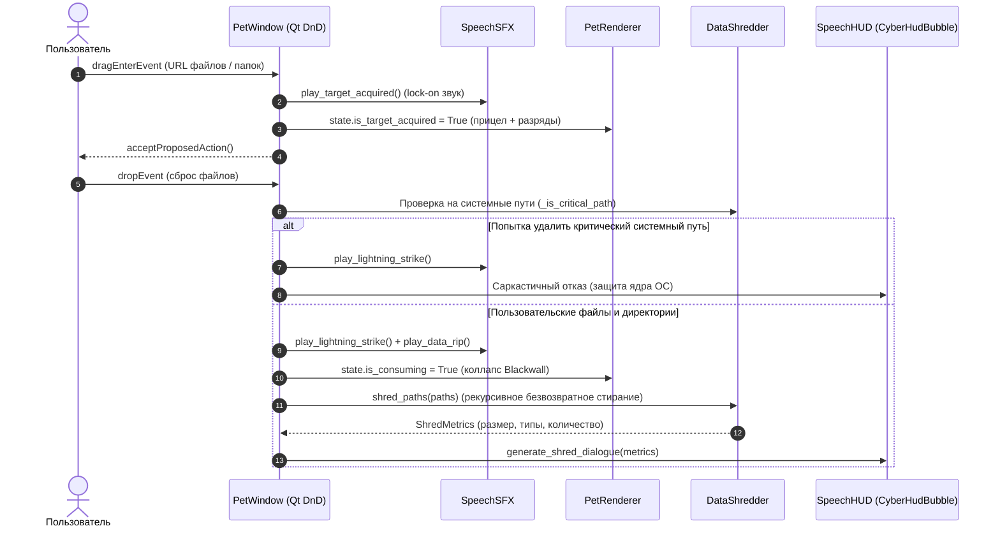
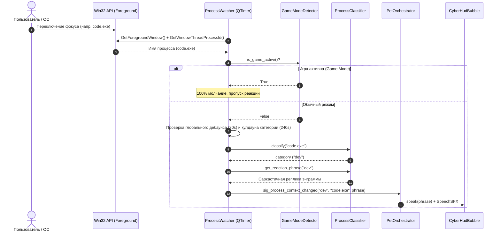
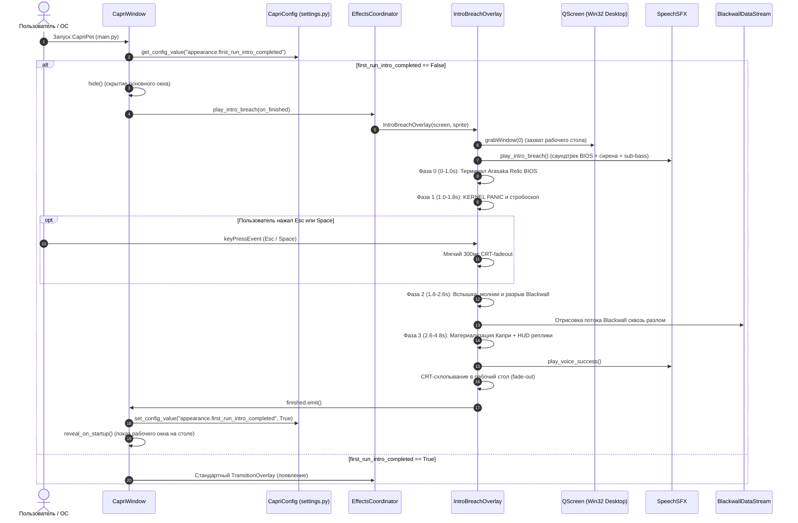

# Архитектура CapriPet

Документ описывает программную архитектуру кибер-питомца CapriPet: взаимодействие подсистем, конвейер обработки речи, выполнение команд и отображение визуальных компонентов на базе PySide6 (Qt).

---

## 1. Общая архитектурная схема (C4 / Container & Component Level)

---

## 2. Диаграмма последовательности голосовой команды (Sequence)

Ниже показан путь прохождения голосовой команды от микрофона до исполнения и обратной связи через HUD.

---

## 3. Описание ключевых подсистем

1. **`capri.audio`**: Непрерывный низкоуровневый захват с аудиокарты, отсечение тишины моделью Silero VAD и передача активных отрезков в локальную модель ASR (Vosk).
2. **`capri.core`**: Выделение триггерных фраз имени питомца, лемматизация и стемминг русской речи, поддержание контекста ожидания подтверждения («да/нет» для критических действий).
3. **`capri.controllers`**: Оркестратор выступает диспетчером между событиями аудио, пользовательскими окнами Qt и запуском командных сценариев.
4. **`capri.commands` & `capri.integrations`**: Изолированные обработчики действий — поиск приложений, управление питанием Windows, взаимодействие со Spotify API и Discord RPC.
5. **`capri.ui` & `capri.effects`**: Полностью процедурный интерфейс на PySide6 в кинетическом дуотоне Studio Trigger (Hot Pink / Acid Green, frameless-окна со скосами под 45°, реактивный эквалайзер Voice HUD, CRT-коллапс луча, экшен-линии и ретро-синтез речи).

---

## 4. Диаграмма последовательности Drag & Drop File Shredder (Rogue AI)

Процесс перехвата и безвозвратного поглощения файлов и папок через окно питомца под эффекты Blackwall.

---

## 5. Диаграмма последовательности телеметрии процессов (ProcessWatcher)

Гибридный сбор системной телеметрии активных окон (Win32) и фоновых процессов (psutil) с валидацией кулдаунов и реакцией Капри.

---

## 6. Диаграмма последовательности первого появления Капри (Arasaka Biochip Hijack)

Кинематографичный оверлей первого запуска: эмуляция консоли BIOS Arasaka Relic, аварийный сбой памяти, кинетический прорыв энграммы Капри сквозь Blackwall и возможность пропуска (Esc/Space).

---

## 7. Модель безопасности и границы доверия (Blackwall ICE)

Для предотвращения локального повышения привилегий (LPE), повреждения системных файлов Windows и исполнения произвольного кода в CapriPet реализована многоуровневая изоляция:

1. **Контур деструктивных операций (`DataShredder`, `SystemCleaner`):**
   - **Path Traversal & Symlink Defense:** Все пути нормализуются через `os.path.realpath()` и `pathlib.Path.resolve()`. Блокируются попытки передачи относительных путей (`..`), символических ссылок и точек соединения (Junctions), ведущих в системные каталоги.
   - **Черный список критических путей:** `%SystemRoot%`, `%ProgramFiles%`, `%ProgramFiles(x86)%`, `%ProgramData%`, `%WinDir%`, `%PUBLIC%`, каталоги учетных записей `C:\Users`, корни всех дисков (`C:\`, `D:\`), UNC-пути (`\\server\share`) и альтернативные потоки данных NTFS (ADS `file.txt:stream`).
   - **Изоляция очистки временных файлов:** Модуль `SystemCleaner` гарантирует, что удаление происходит строго внутри канонических границ каталогов `%TEMP%` (`is_relative_to`), а симлинки удаляются без перехода по ним.

2. **Контур внешних вызовов и сети (`AppLauncher`, `WebSearch`):**
   - **Белый список расширений:** Разрешен запуск только проверенных исполняемых файлов (`.exe`, `.lnk`). Прямой запуск опасных сценариев (`.bat`, `.cmd`, `.vbs`, `.ps1`, `.scr`) заблокирован.
   - **Сетевые шлюзы (`safe_open_url`):** Открытие ссылок в браузере ограничено исключительно веб-схемами (`http://`, `https://`). Попытки вызова кастомных ОС-протоколов (`file://`, `ms-msdt:`, `calculator:`) нейтрализуются.

3. **Контур входных данных и конфигурации (`Settings`, `InputFlow`, `Registry`):**
   - **Защита от JSON-бомб:** Конфигурационный файл защищен строгим лимитом размера (`MAX_CONFIG_FILE_SIZE = 2 МБ`). При превышении размера файл считается поврежденным и сбрасывается в дефолтное безопасное состояние.
   - **DoS / ReDoS защита:** Длина входящих текстовых и распознанных ASR команд ограничена лимитом в 500 символов, предотвращая исчерпание процессорного времени при нечетком поиске (`rapidfuzz`, стемминг).

